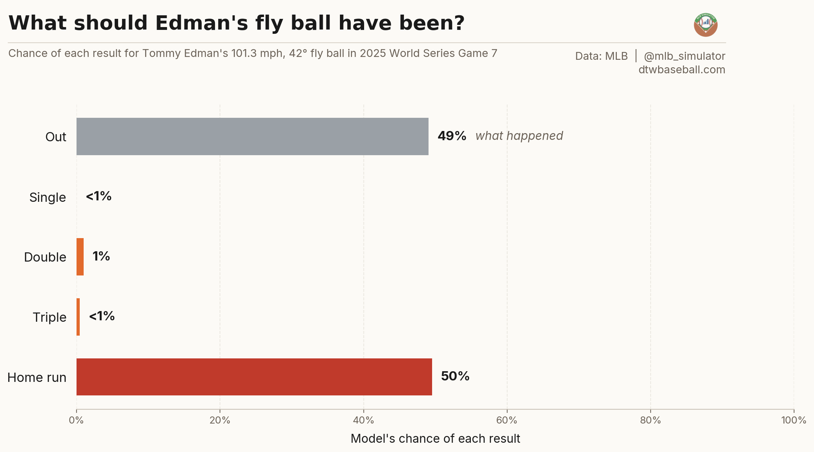
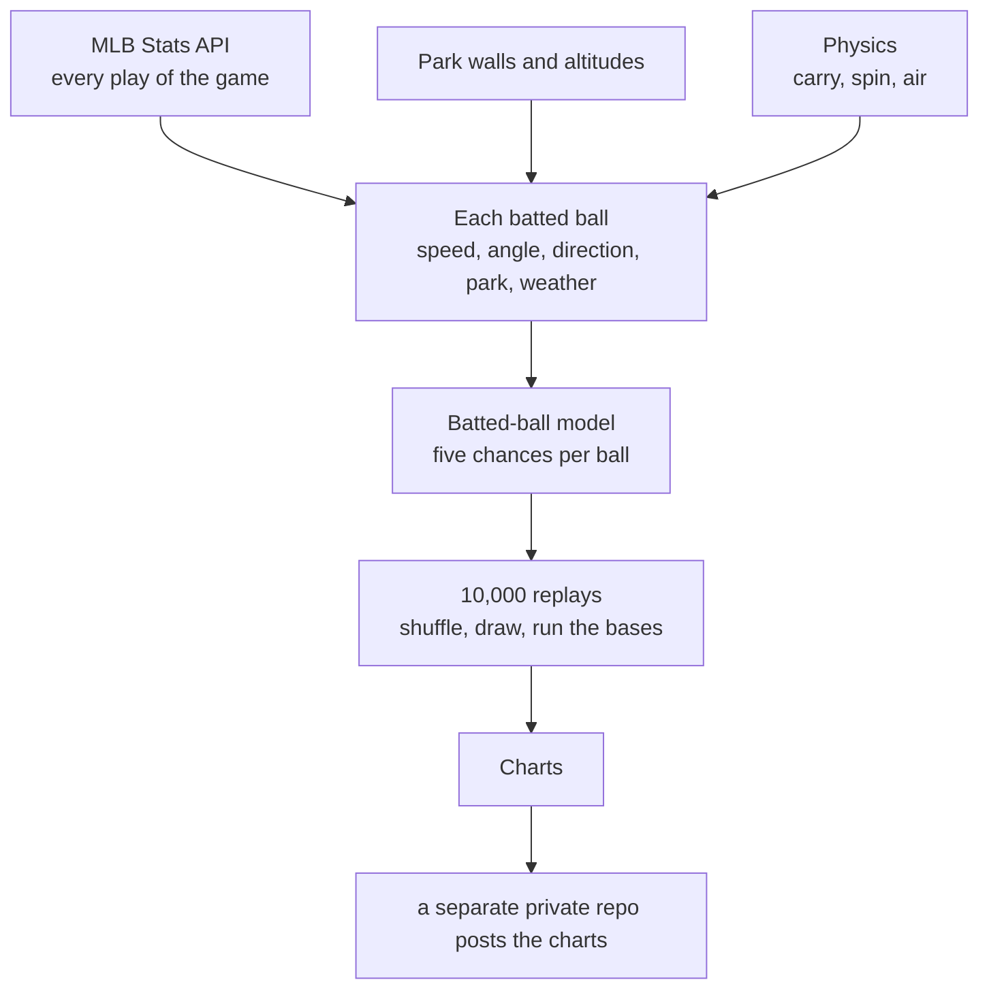
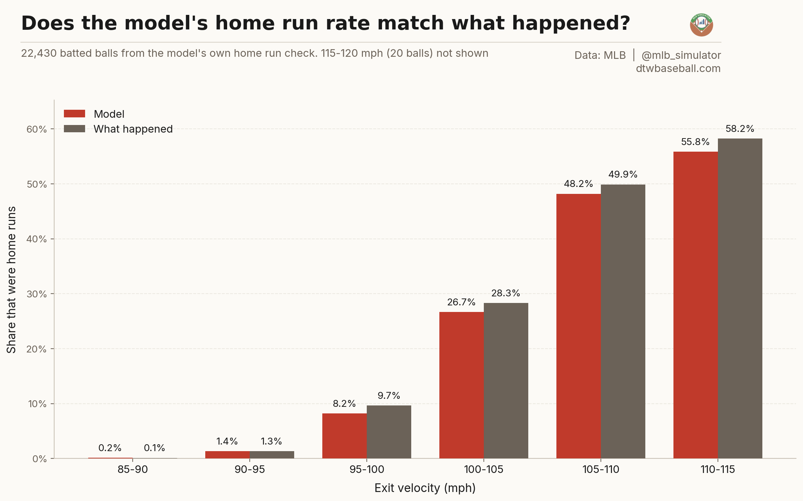
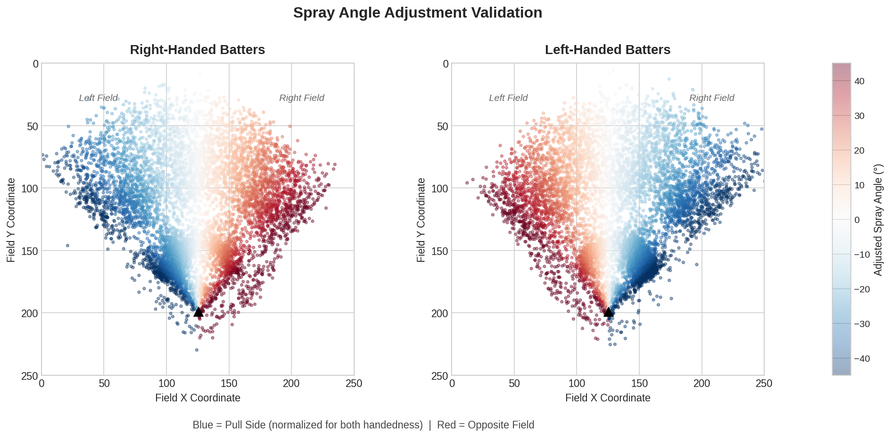
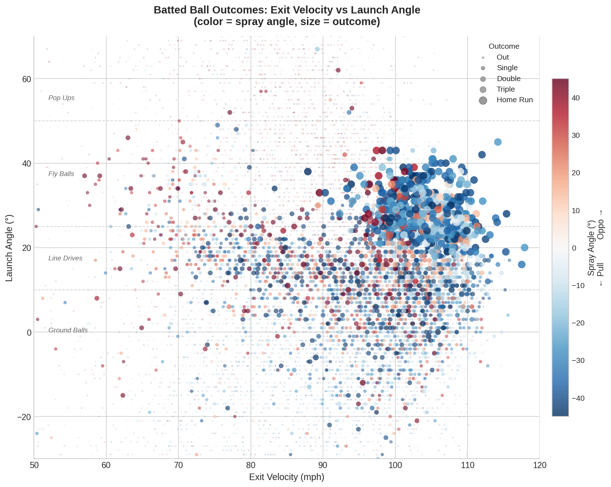

# MLB Deserve-to-Win Simulator

### https://x.com/mlb_simulator
### [@mlb-simulator.bsky.social](https://bsky.app/profile/mlb-simulator.bsky.social)

> **Analysts:** the model, its scores and its formulas are in [For analysts](#for-analysts).
>
> **Developers:** install, tests and the file tree are in [For developers](#for-developers).

## Who deserved to win Game 7?

The Dodgers won Game 7 of the 2025 World Series 5 to 4, in 11 innings at Rogers
Centre. That is how the night went once, and once is all a box score can show.

I built this simulator to ask how the same night would go if it were dealt out
again. It keeps every batted ball, walk, strikeout, steal and pickoff each team
had, lets a model decide fresh what each batted ball becomes, and plays the game
10,000 times. With that many replays, no single bounce decides the answer.

Replayed that way, Game 7 goes to the Dodgers 61 times in 100 and to the Blue
Jays 29 times. The team that won was also the team that deserved to, by about
two to one.


The other 10 replays in 100 are ties, since each team's replay is scored on its
own and the simulator plays no extra innings when the two totals match.

## What does "deserve" mean?

Start with one ball. In the top of the 2nd inning, Tommy Edman hit a fly ball
that left the bat at 101.3 mph and rose at 42 degrees, which is hard and high.
Edman pulled it toward right field, and right fielder Addison Barger caught it.
Before you read on, decide what that ball should have been.

The box score has already decided. It is an out, worth exactly what a pop-up to
the catcher is worth. The simulator answers a different question. It asks how
often a ball hit this hard, this high, in this direction and in this park
becomes each result, and it uses those chances in place of what happened.



The model calls Edman's fly ball a coin flip. It gives the ball a 49 percent
chance of being an out and a 50 percent chance of being a home run, with almost
nothing left for anything in between. The Blue Jays got the better half of that
flip.

The ball itself came down 319 feet from the plate, about 24 feet short of the
wall on that line. The model never sees where a ball lands. It sees only how the
ball left the bat, and by its count a ball that leaves the bat this way is a
home run about half the time.

On this page, a ball deserves what it was worth across every result it could
have had, not the one result it got. To put that worth in one number, I weight
each result by the bases it is worth, add them up, and call the total estimated
bases.

```math
\text{estimated bases} = p_{1B} + 2\,p_{2B} + 3\,p_{3B} + 4\,p_{HR}
```

Read aloud: the chance of a single, plus twice the chance of a double, plus three
times the chance of a triple, plus four times the chance of a home run.

Symbols: $p_{1B}$, $p_{2B}$, $p_{3B}$ and $p_{HR}$ are the model's chances that
the ball becomes a single, a double, a triple or a home run. An out is worth no
bases, so it has no term.

Edman's fly ball comes to 2.01 estimated bases, about the value of a double, for
a ball the box score counts as nothing. The replays above draw every batted
ball's result from chances like these.

## Where does the data come from?

Everything the simulator knows about a game comes from the MLB Stats API, the
league's public feed of every play. For each ball put in play it reads how hard
the ball left the bat, the angle it left at, where on the field it ended up,
which side of the plate the batter hit from, and the park. For the game as a
whole it reads the temperature the feed reports and whether the roof was
closed. Every strikeout, walk, hit batter, stolen base and pickoff comes along
too, since the replays use them.

For Game 7 that is 37 batted balls for the Dodgers and 33 for the Blue Jays.
Those 70 balls are what every replay decides again.

The model learned what a batted ball is worth from three seasons, each with its
own job. It learned its patterns from about 126K batted balls in 2024, was
calibrated on about 127K from 2025, and was tested on about 79K from 2026.
Calibrating means checking the model's chances against a season it did not
learn from and adjusting them, so that across many balls its chances match how
often things really happened.

Testing on 2026 asks the question the simulator faces every night, which is how
the model does on games it has never seen. The scores from that test are in
[For analysts](#for-analysts).

## How does the model read a ball?

The model turns a batted ball into five chances from four kinds of information,
and I added each one to answer a problem the one before it left open. Edman's
fly ball goes through every step with its own numbers.

### How hard and how high

Speed and angle come first, since they say most of what happens to a ball. A
soft ground ball and a scorched line drive need nothing else to be told apart.

They leave the hardest balls unsettled, though. A ball hit as hard and as high
as Edman's can clear the wall in one direction and land in a glove in another,
so speed and angle alone cannot decide it.

### Which way it went

Direction answers part of that. The wall is closer down the lines than in
center field, so a fly ball pulled down a line has less wall to clear than the
same ball hit to center. A left-handed batter pulls the ball to right field and
a right-handed batter pulls it to left, so I measure the angle from the
batter's side of the plate, where a pulled ball points the same way for both.

Edman batted left-handed and pulled the ball toward the right-field line, about
39 degrees off center.

### The park

A fly ball that clears the wall in one park is a long out in another. Earlier
versions of the model handled that with one learned adjustment per stadium. I
dropped it, since one number for a whole park cannot tell a short corner from a
deep center field.

In its place the model gets two facts about the park. The first is the distance
to the wall along the line this ball was hit, read from an outline of each
park's wall. The second is the park's altitude, since thinner air carries a ball
farther. On the model's outline of Rogers Centre, the wall along Edman's line
stood about 343 feet away, and the park sits 266 feet above sea level.

From those, the model makes a first estimate of how far the ball would fly
through that park's air, with drag and gravity and nothing else. By that
estimate Edman's ball carries about 393 feet and clears the wall by about 49. I
tried adding lift to this first estimate, and it did not make the model better,
so it stays drag only.

### Spin and air

Drag alone flies a ball as if it had no spin, and a batted ball always spins.
Spin lifts a ball, bends it and adds drag. So the model estimates each ball's
spin from its launch angle, its direction and the batter's side, using formulas
from Alan Nathan's research on the physics of baseball. Then it flies the ball
again with the lift and the drag that spin creates.

The estimate gives Edman's ball about 4,400 revolutions a minute, much of it
sideways. With that spin the ball comes down about 346 feet out, only about 3
feet past the wall.

Temperature is the last piece. Warm air is thinner than cold air and lets a ball
carry farther, so the model reads the game-time temperature from the feed. Game
7 was played under a closed roof at 68 degrees, and at that temperature Edman's
ball comes down about 345 feet out, 2 feet past the wall.

By the physics, then, Edman's ball reached the wall with almost nothing to
spare, which is a fair place for a coin flip.

## How is the game replayed?

Each replay deals one team's night back out in a new order and lets the model
decide every batted ball again. Here is one replay for one team.

The simulator takes every batted ball, strikeout, walk, hit batter, steal and
pickoff the team had, shuffles them into a random order, and plays them one at a
time. A strikeout is an out. A walk or a hit batter puts the batter on first and moves
runners up only when they are forced. A steal moves the lead runner up a base,
and a pickoff removes the lead runner for an out.

A batted ball gets a random draw against its five chances, like a roll of a die
weighted by the model, and becomes an out, a single, a double, a triple or a
home run.

Runners move up as many bases as the hit, with three exceptions where real
runners often take more. A runner on second scores on a single 56 times in 100
and otherwise stops at third. A runner on first reaches third on a single 26.5
times in 100 when second base is empty, and otherwise stops at second. A runner
on first scores on a double 67.5 times in 100 and otherwise stops at third. I
set each of those halfway between the simulator's original rules and the major
league averages.

Every three outs the bases clear and a new inning starts. When the team's events
run out, the replay is over, and its runs are the team's score. The other team
is replayed the same way, the higher score wins, and the simulator does all of
it 10,000 times. The win shares in the first section are the share of those
replays each team won.

One adjustment happens only in the replays. For a ball hit 100 mph or harder,
the home run chance goes up slightly and the out chance gives up the same
amount, as [For analysts](#for-analysts) shows. It moves Edman's ball from a 50
percent home run to 51 percent.

The whole path, from the feed to the charts, is below. A separate private repo
runs the daily job and posts the charts.



The night's batted balls also get three charts of their own. The spray chart
puts each team's batted balls where they went, ringed in the color of what the
model thought each one was worth.


The estimated bases table ranks the night's 15 most valuable batted balls by
that worth, and Edman's caught fly ball is sixth.


The player chart adds up each hitter's estimated bases, with one base for each
walk, and each pitcher's estimated bases allowed.


## What does the simulator miss?

The replays judge contact, and they leave out most of what happens after the
ball leaves the bat. Some of those gaps give a team runs in a replay and some
take runs away.

Defense is the biggest. The model knows how a ball was hit, not who was standing
where, so a diving catch in the real game is a hit in many replays. A ball a
fielder misplayed is judged only by how it was hit, and errors do not exist in a
replay. When the feed has no measurements for a ball in play, the replays count
it as an out if the real play was not a hit, and drop it if it was.

Lineup order does not exist either. The shuffle hands out a team's events in a
random order, so a lineup that strings its hits together gets no credit for it,
and one that scatters them gets no blame.

Strikeouts and walks are fixed. A replay keeps the real game's strikeouts, walks
and hit batters as they were, and only the balls in play are decided again. Any
other plate appearance that ends without a ball in play is left out, which in
Game 7 drops one of the Blue Jays' 12 strikeouts, the one that ended in a double
play.

Outs are simpler than in a real game. An out in a replay is always one out, so a
double play takes one out and not two. A runner never moves up on an out, so a
sacrifice fly is just an out. The first rule gives a replay runs the real game
did not have, and the second takes some away.

A replay can also run longer or shorter than the real game, since it ends when
a team's events run out and not after nine innings. A home team that wins
without batting in the bottom of the ninth brings fewer events to its replays
than the visitors bring to theirs, which tilts the replays toward the visitors.

The replays also score more than the real night did. The Dodgers' most common
replay total is 9 runs and the Blue Jays' is 7, beside a real 5 to 4.

Part of that is the contact. By the model's count, the Dodgers' batted balls
were worth about 29 bases and got 21, while the Blue Jays' were worth about 22
and got 20. The Dodgers lost far more to the night's catches and bounces than
the Blue Jays did. The rest comes from the replay itself, since the Blue Jays'
contact was worth close to what it got and their replays still score about
twice their real 4 runs.

Both teams play by the same rules, which is why I read the replays for which
team hit the ball better and not for how many runs either one should have
scored. The rules do not cost both teams the same, though, since a team that hit
into more double plays on the night gets more of them back.

The strongest objection is Edman's ball itself. It fell short of the wall, as
the second section says, so a fan could fairly argue that the Blue Jays earned
that out and the physics simply missed. The out was real, and the box score
keeps it. The simulator asks a narrower question, what a ball that leaves the
bat this way is usually worth, and its answer is a home run about half the time.
A ball that dies short is the other half of that answer, not a sign the answer
is wrong.

Some of this I would like to change. Player speed, from sprint speed or steals
per plate appearance, would let fast runners take the extra base more often.
Double plays drawn from each ground ball's chances would take away runs the
replays now give for free. A layered model could predict each result with the
other results' chances in hand, and each team's usual run totals could shape how
likely each replay is. Each would move the answer for some games, and none would
change what the answer means.

The box score says who won, and the replays say whose contact deserved to.

## For analysts

This section is for readers who want to check or rebuild the model. Nothing
above depends on it.

### The model

The batted-ball model is scikit-learn's histogram gradient boosting
classifier, a long chain of small decision trees in which each tree corrects
the ones before it, wrapped in sigmoid calibration. It takes 28 inputs, 26
numbers and 2 categories, known in the code as feature set F6. It returns five
chances that add to one, for an out, a single, a double, a triple and a home
run.

It was fit on 125,778 batted balls from 2024, calibrated on 126,774 from 2025
and tested on 78,602 from 2026, so every test ball comes from a season the
model never saw while it was built. Sigmoid calibration fits an S-shaped curve
from the trees' raw scores to chances on the 2025 season, and scikit-learn's
[calibration guide](https://scikit-learn.org/stable/modules/calibration.html)
explains it.

### How good is it?

All three scores are on the 78,602 test balls from 2026.

Accuracy is 0.826, which means the model's most likely result was the real
result for 82.6 percent of test balls. That sounds better than it is, since
most batted balls are outs. In this repo's 2025 batted balls 67.8 percent were
outs, so a model that always said "out" would be right about two times in
three. Accuracy also checks only the top choice, and the replays use all five
chances.

Log loss is 0.4388, and lower is better. It scores the chance the model gave to
what really happened, and it punishes a confident miss far more than a cautious
one, which matters because the replays draw from the chances themselves. The
model before this one, with the park inputs but without spin and temperature
(feature set F3), scored 0.4469 on the same test set, according to the deploy
record in commit `691dec4`.

CRPS, the continuous ranked probability score, is 0.174 on total bases. It
compares the whole spread of bases the model expected with the bases the ball
really got, and lower is better. A model that put all of every ball's chance on
its real result would score 0.



The chart puts the model's home run rate beside the real one for each band of
exit velocity. From 95 to 115 mph the model reads slightly low, by about one and
a half to two and a half percentage points. The model's metadata does not say
which batted balls this check covers, so read it as the model's own check and
not as a test on unseen games.

### The inputs

The 28 inputs, grouped by what they describe:

| Group | Features |
|-------|----------|
| Contact quality | `hitData_launchSpeed`, `hitData_launchAngle`, `launch_speed_squared`, `is_barrel`, `launch_angle_category` |
| Distance | `distance_proxy`, `hr_distance_proxy` |
| Spray | `spray_angle_adj` (handedness-adjusted, negative = pull side), `spray_angle_abs`, `spray_direction`, `is_pulled`, `is_opposite` |
| Interactions | `pulled_hard`, `oppo_hard`, `spray_ev_interaction`, `pulled_ground_ball`, `oppo_line_drive` |
| Park geometry | `altitude_ft`, `wall_distance_ft`, `carry_ft`, `over_fence_margin` |
| Spin | `total_spin_rpm`, `sidespin_abs_rpm`, `carry_ft_spin`, `over_fence_margin_spin` |
| Temperature | `temp_f`, `carry_ft_spin_temp`, `over_fence_margin_spin_temp` |

Every input comes from what the live feed gives for one ball, which is exit
velocity, launch angle, hit coordinates, batter side, the park, and the
game-time temperature with the roof state. The park inputs replaced a
per-stadium `venue_id` category in 2026, after the study in
`Research/venue_effects_eda.ipynb`. The wall outlines and altitudes also cover
two parks the Athletics use, Sutter Health Park and Las Vegas Ballpark.

Temperature passes through `sanitize_temp` in `Model/feature_engineering.py`
before it is used. A missing reading becomes 70°F. A closed-roof reading outside
50 to 95°F becomes 72°F, since the feed sometimes reports the outdoor
temperature for a closed roof. Every other reading is clipped to 35 to 105°F.

The first carry estimate, `carry_ft`, is drag only. Magnus lift is written into
it behind `_USE_LIFT` and switched off, since it did not improve log loss,
calibration error or the home run tail. The spin-aware carries,
`carry_ft_spin` and `carry_ft_spin_temp`, come from `Model/bbe_physics.py`,
which follows Nathan's spreadsheet and does include lift. The two flights differ
on purpose, and changing either one means a retrain.

### The formulas

The formulas run in the order a ball's numbers flow, from the air to the win
share, and each is transcribed from the function named under it. The step from
five chances to estimated bases is the formula in
[What does "deserve" mean?](#what-does-deserve-mean) and is not repeated here.

The first carry estimate flies the ball in steps of 0.005 seconds from 1 metre
off the ground, at its measured speed and angle, through still air whose
density falls with the park's altitude, until it lands.

```math
\begin{aligned}
\rho &= 1.225\, e^{-h/8500} \\
\frac{d\vec{v}}{dt} &= -\frac{\rho\, C_D\, A}{2m}\, \lvert \vec{v} \rvert\, \vec{v} - g\, \hat{z}
\end{aligned}
```

Read aloud: the air's density is its sea-level density, shrunk the higher the
park sits. At each step the ball slows by an amount that grows with the air's
density and with the square of its speed, and gravity pulls it down.

Symbols: $\rho$ is the air density in kg/m³, $h$ the park's altitude in metres,
$\vec{v}$ the ball's velocity, $C_D = 0.30$ the drag coefficient, $A = 0.00426$
m² the ball's cross-section, $m = 0.145$ kg its mass, $g = 9.81$ m/s² gravity and
$\hat{z}$ the upward direction. The carry is where the ball comes back to the
ground, in feet. From `_drag_carry_scalar` in `Model/feature_engineering.py`.

Spin is estimated from the launch angle, the direction and the batter's side
with the regressions in Nathan's Trajectory Calculator.

```math
\begin{aligned}
\omega_b &= -763 + 120\,\theta + 21\,s \\
\omega_s &= -\sigma\,(849 + 94\,s) \\
\omega &= \sqrt{\omega_b^2 + \omega_s^2}
\end{aligned}
```

Read aloud: backspin rises with the launch angle and with how far the ball went
toward the opposite field, and a low ball comes out with topspin. Sidespin is a
base amount plus a share of the direction angle, and the batter's side sets
which way it turns. Total spin combines the two the way the two short sides of a
right triangle make the long one.

Symbols: $\theta$ is the launch angle in degrees, $s$ the spray angle in degrees
measured from the batter's side (negative when pulled, positive toward the
opposite field), $\sigma$ is 1 for a right-handed batter and -1 for a
left-handed one, and $\omega_b$, $\omega_s$ and $\omega$ are backspin, sidespin
and total spin in revolutions a minute. From `nathan_spin` in
`Model/bbe_physics.py`. Edman's ball, at 42 degrees and -38.6 batting
left-handed, gets 3,467 of backspin, -2,776 of sidespin and 4,442 in total.

The spin-aware flight measures the air with Nathan's formula, which also uses
the game temperature, at standard pressure and 50 percent humidity.

```math
\begin{aligned}
T &= 21.1 + \tfrac{5}{9}\,(t - 70) \\
e_s &= 4.5841\, \exp\!\left(\frac{(18.687 - T/234.5)\,T}{257.14 + T}\right) \\
\rho &= 1.2929 \cdot \frac{273}{T + 273} \\
&\quad \cdot \frac{760\, e^{-1.217\times 10^{-4}\, h} - 0.3783 \cdot 50 \cdot e_s/100}{760}
\end{aligned}
```

Read aloud: the temperature in Celsius is counted from 21.1 degrees at 70
Fahrenheit. The pressure of the water vapor the air can hold rises with the
temperature. The air's density falls as the temperature rises and as the park
sits higher, and falls a little more for the water vapor in it.

Symbols: $t$ is the game temperature in °F after the guard above, $T$ the same
in °C, $e_s$ the saturation vapor pressure in mmHg, $h$ the park's altitude in
metres and $\rho$ the air density in kg/m³. The flight's drag and lift both
scale with $K = 0.07182\,\rho'$, where $\rho'$ is $\rho$ in lb/ft³. From
`air_density_K` in `Model/bbe_physics.py`.

`spin_aware_carry` then flies the ball in steps of 0.01 seconds from 3 feet up,
with a drag coefficient that rises with total spin and a Magnus lift coefficient
that rises with the ratio of spin to speed, as Nathan's spreadsheet does. It
flies once at 70°F and once at the game temperature.

Each carry becomes a margin by subtracting the distance to the wall along the
ball's line.

```math
m = c - w(\phi)
```

Read aloud: how far past the wall the ball would come down, below zero when it
falls short.

Symbols: $m$ is the margin in feet, $c$ one of the three carries (drag only,
spin-aware, spin-aware at the game temperature), and $w(\phi)$ the wall distance
at spray angle $\phi$ measured from the plate (negative toward left field,
positive toward right). The wall distance comes from casting a ray along
$\phi$ to the park's wall outline in `Model/data/mlb_park_walls.csv`, or is 374
feet when the park or the ray is missing. From `create_features_for_prediction`
in `Model/feature_engineering.py`. Edman's three margins are 49.3, 2.8 and 2.1
feet.

In the replays only, a ball hit 100 mph or harder has its home run chance scaled
up, and its out chance gives up the difference.

```math
\begin{aligned}
p'_{HR} &= f(v)\,p_{HR} \\
p'_{out} &= \max\bigl(0,\ p_{out} - (f(v) - 1)\,p_{HR}\bigr) \\
f(v) &= \begin{cases} 1.02 & 100 \le v < 105 \\ 1.05 & 105 \le v < 200 \\ 1 & \text{otherwise} \end{cases}
\end{aligned}
```

Read aloud: the new home run chance is the old one times a factor, and the out
chance drops by what the home run chance gained, never below zero. The factor is
1.02 from 100 to 105 mph, 1.05 from 105 mph up, and 1 below 100 mph.

Symbols: $p_{HR}$ and $p_{out}$ are the model's raw home run and out chances,
$p'$ the chances the replays draw from, $v$ the exit velocity in mph and $f(v)$
the factor. The single, double and triple chances do not change. From
`_apply_hr_tail_correction` and `HR_TAIL_CORRECTIONS` in
`Simulator/game_simulator.py`. Edman's home run chance goes from 0.4953 to
0.5052.

A team's win share is the share of replays in which it outscored the other
team.

```math
W = \frac{1}{N} \sum_{i=1}^{N} \mathbf{1}\left[R_i > R_i'\right]
```

Read aloud: the number of replays the team won, divided by the number of
replays.

Symbols: $N$ is the number of replays (10,000 on this page), $R_i$ and $R_i'$
the team's and the other team's runs in replay $i$, and $\mathbf{1}[\cdot]$ is 1
when the bracket is true and 0 when it is not. Equal totals count as ties. From
`simulator` in `Simulator/game_simulator.py`.

### Three things to know

**The home run bump is in the replays only.** The chances on the one-ball chart,
in the estimated bases table and in every row the simulator exports are the
model's raw output. Adding the bump there would change the scoring scale partway
through a season, so it stays out.

**The model and the charts use two spray-angle vertices, on purpose.** The model
measures spray angles from the hit-coordinate origin (125.42, 199.02), which was
fitted for distance and not for angle. Measured from it, about 4.9 percent of
2024 home runs and 4.7 percent of 2025 home runs land beyond the foul lines. The
spray chart and the Pull, Center and Oppo labels measure from a calibrated
vertex, (127.4, 215.0), where those shares fall to 0.23 and 0.12 percent. Every
shipped model learned from angles measured the first way, so moving the model's
vertex means new wall outlines and a retrain.
[Documentation/spray_angle_calibration.md](Documentation/spray_angle_calibration.md)
has the evidence.

**Two engines run the replays.** A vectorized NumPy engine in
`Simulator/vector_engine.py` runs by default. Its tables are built at import from
the scalar reference functions in `Simulator/game_simulator.py`, so the
baserunning rules live in one place. Set `DTW_SCALAR_SIM=1` to run the scalar
path instead. The two draw random numbers in different orders, so a seed
reproduces each engine on its own but not one from the other, and
`tests/test_engine_parity.py` checks that their run distributions agree. Both
engines can also replay a game inning by inning (`outcomes_by_inning` and
`simulator_by_inning`), which feeds the per-inning run charts.

### Two checks on the inputs

The two plots below come from
[Documentation/readme_image_generator.ipynb](Documentation/readme_image_generator.ipynb).
The first checks the handedness adjustment, so that the pull side means the same
thing for right- and left-handed batters. Blue is the pull side and red the
opposite field.



The second shows how exit velocity and launch angle combine into results, with
color for spray angle (blue pulled, red opposite field) and marker size for how
good the result was.



## For developers

### Install and test

```bash
git clone https://github.com/dgrifka/baseball_game_simulator.git
cd baseball_game_simulator
python -m venv .venv && source .venv/bin/activate
pip install -r requirements.txt pytest
pytest tests/ -q
```

`scikit-learn` is pinned in `requirements.txt` because
`Model/batted_ball_model.pkl` is a pickled scikit-learn pipeline, and unpickling
across versions is not guaranteed.

The suite has about 175 tests and runs in about ten seconds from the repo root.
CI (`.github/workflows/ci.yml`) runs the same command on Python 3.11 and 3.12
for every push to `main` and every pull request.

### Images

- `python Documentation/make_readme_images.py` redraws the four Game 7 charts.
  It fetches the game (gamePk 813024) and replays it 10,000 times with seed
  20251101, so the win shares come out the same on every run.
- `python Documentation/make_article_figures.py` redraws the one-ball chart,
  which fetches the same game, and the home run check. Add `--only hr_check` to
  redraw the home run check alone, with no network.
- The two input checks come from `Documentation/readme_image_generator.ipynb`.

### Files

```
baseball_game_simulator/
├── .github/                        # CI workflow and Dependabot
├── Data/                           # Historical parquet and CSVs for notebooks and tests
├── Documentation/
│   ├── Images/                     # Every image on this page
│   ├── make_readme_images.py       # The four Game 7 charts
│   ├── make_article_figures.py     # The one-ball chart and the home run check
│   └── readme_image_generator.ipynb, spray_angle_calibration.md
├── Model/
│   ├── data/                       # Park wall outlines and altitudes
│   ├── batted_ball_model.pkl       # The shipped model (scikit-learn pipeline)
│   ├── bbe_physics.py              # Spin, air density and spin-aware carry
│   ├── feature_engineering.py      # Spray angle, park geometry and the 28 inputs
│   └── model_metadata.json         # Inputs, split sizes and scores
├── Research/                       # Season win-probability and venue-effects notebooks
├── Simulator/
│   ├── game_simulator.py           # Outcomes, baserunning, scalar replays
│   ├── vector_engine.py            # Vectorized replays (the default)
│   ├── get_game_information.py     # MLB Stats API client
│   └── visualizations.py, style.py # The game charts and their shared style
├── tests/                          # pytest suite, incl. test_article_figures_script.py
└── requirements.txt, pyproject.toml
```

## Research

- [Who Deserved to Win: Building an MLB Game Outcome Simulator](https://medium.com/@dmgrifka_64770/who-deserved-to-win-building-an-mlb-game-outcome-simulator-b4a8d4bca2a9)
- [Applying Bayesian Hierarchical Methods to MLB Season Win Probabilities with PyStan](https://medium.com/@dmgrifka_64770/applying-bayesian-hierarchical-methods-to-mlb-season-win-probabilties-with-pystan-468572abb932)

## Credits

This account was inspired by @MoneyPuckdotcom. The model and the account are
built on data from the MLB Stats API, and the spin and carry physics are seeded
from Alan Nathan's public research (the Trajectory Calculator and "Analysis of
Baseball Trajectories", 2017).

## License

MIT, see [LICENSE](LICENSE).

## Contact

Derek Grifka, https://dgrifka.github.io/

Feel free to open a pull request with fixes or improvements.
