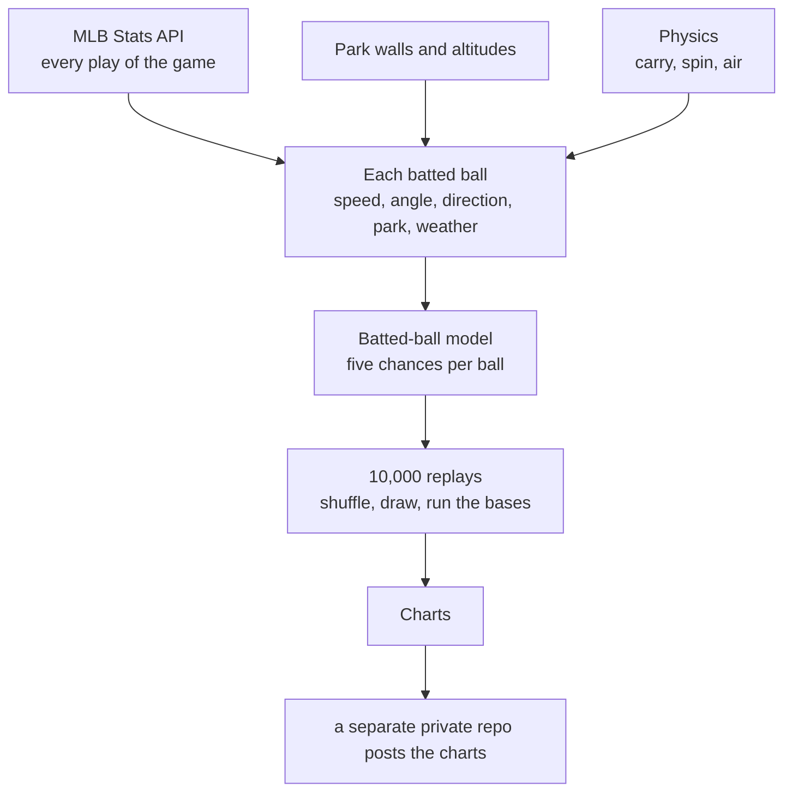
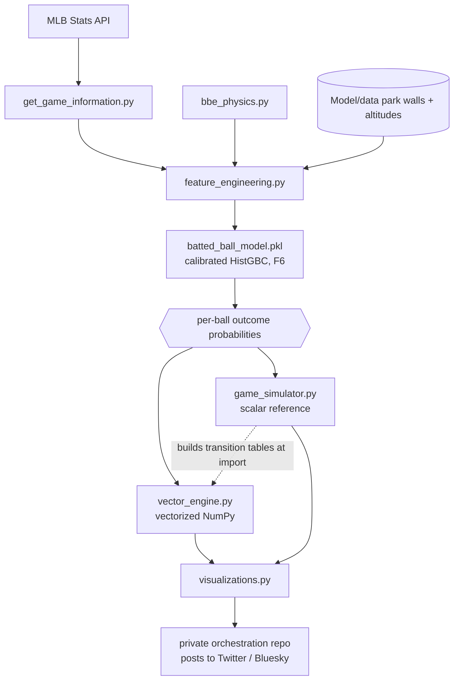

# MLB Deserve-to-Win Simulator

### https://x.com/mlb_simulator
### [@mlb-simulator.bsky.social](https://bsky.app/profile/mlb-simulator.bsky.social)

> **Analysts:** the model, its scores and its formulas are in [For analysts](#for-analysts).
>
> **Developers:** install, tests and the file tree are in [For developers](#for-developers).

## Who deserved to win Game 7?

The Dodgers won Game 7 of the 2025 World Series 5 to 4, in 11 innings at Rogers
Centre. That is how the night went once, and once is all a box score can show.

I built this simulator to ask how the same night would go if it were dealt out
again. It keeps every batted ball, walk, strikeout, steal and pickoff each team
had, lets a model decide fresh what each batted ball becomes, and plays the game
10,000 times. With that many replays, no single bounce decides the answer.

Replayed that way, Game 7 goes to the Dodgers 61 times in 100 and to the Blue
Jays 29 times. The team that won was also the team that deserved to, by about
two to one.


The other 10 replays in 100 are ties, since each team's replay is scored on its
own and the simulator plays no extra innings when the two totals match.

## What does "deserve" mean?

Start with one ball. In the top of the 2nd inning, Tommy Edman hit a fly ball
that left the bat at 101.3 mph and rose at 42 degrees, which is hard and high.
Edman pulled it toward right field, and right fielder Addison Barger caught it.
Before you read on, decide what that ball should have been.

The box score has already decided. It is an out, worth exactly what a pop-up to
the catcher is worth. The simulator answers a different question. It asks how
often a ball hit this hard, this high, in this direction and in this park
becomes each result, and it uses those chances in place of what happened.


The model calls Edman's fly ball a coin flip. It gives the ball a 49 percent
chance of being an out and a 50 percent chance of being a home run, with almost
nothing left for anything in between. The Blue Jays got the better half of that
flip.

The ball itself came down 319 feet from the plate, about 24 feet short of the
wall on that line. The model never sees where a ball lands. It sees only how the
ball left the bat, and by its count a ball that leaves the bat this way is a
home run about half the time.

On this page, a ball deserves what it was worth across every result it could
have had, not the one result it got. To put that worth in one number, I weight
each result by the bases it is worth, add them up, and call the total estimated
bases.

```math
\text{estimated bases} = p_{1B} + 2\,p_{2B} + 3\,p_{3B} + 4\,p_{HR}
```

Read aloud: the chance of a single, plus twice the chance of a double, plus three
times the chance of a triple, plus four times the chance of a home run.

Symbols: $p_{1B}$, $p_{2B}$, $p_{3B}$ and $p_{HR}$ are the model's chances that
the ball becomes a single, a double, a triple or a home run. An out is worth no
bases, so it has no term.

Edman's fly ball comes to 2.01 estimated bases, about the value of a double, for
a ball the box score counts as nothing. The replays above draw every batted
ball's result from chances like these.

## Where does the data come from?

Everything the simulator knows about a game comes from the MLB Stats API, the
league's public feed of every play. For each ball put in play it reads how hard
the ball left the bat, the angle it left at, where on the field it ended up,
which side of the plate the batter hit from, and the park. For the game as a
whole it reads the temperature the feed reports and whether the roof was
closed. Every strikeout, walk, hit batter, stolen base and pickoff comes along
too, since the replays use them.

For Game 7 that is 37 batted balls for the Dodgers and 33 for the Blue Jays.
Those 70 balls are what every replay decides again.

The model learned what a batted ball is worth from three seasons, each with its
own job. It learned its patterns from about 126K batted balls in 2024, was
calibrated on about 127K from 2025, and was tested on about 79K from 2026.
Calibrating means checking the model's chances against a season it did not
learn from and adjusting them, so that across many balls its chances match how
often things really happened.

Testing on 2026 asks the question the simulator faces every night, which is how
the model does on games it has never seen. The scores from that test are in
[For analysts](#for-analysts).

## How does the model read a ball?

The model turns a batted ball into five chances from four kinds of information,
and I added each one to answer a problem the one before it left open. Edman's
fly ball goes through every step with its own numbers.

### How hard and how high

Speed and angle come first, since they say most of what happens to a ball. A
soft ground ball and a scorched line drive need nothing else to be told apart.

They leave the hardest balls unsettled, though. A ball hit as hard and as high
as Edman's can clear the wall in one direction and land in a glove in another,
so speed and angle alone cannot decide it.

### Which way it went

Direction answers part of that. The wall is closer down the lines than in
center field, so a fly ball pulled down a line has less wall to clear than the
same ball hit to center. A left-handed batter pulls the ball to right field and
a right-handed batter pulls it to left, so I measure the angle from the
batter's side of the plate, where a pulled ball points the same way for both.

Edman batted left-handed and pulled the ball toward the right-field line, about
39 degrees off center.

### The park

A fly ball that clears the wall in one park is a long out in another. Earlier
versions of the model handled that with one learned adjustment per stadium. I
dropped it, since one number for a whole park cannot tell a short corner from a
deep center field.

In its place the model gets two facts about the park. The first is the distance
to the wall along the line this ball was hit, read from an outline of each
park's wall. The second is the park's altitude, since thinner air carries a ball
farther. On the model's outline of Rogers Centre, the wall along Edman's line
stood about 343 feet away, and the park sits 266 feet above sea level.

From those, the model makes a first estimate of how far the ball would fly
through that park's air, with drag and gravity and nothing else. By that
estimate Edman's ball carries about 393 feet and clears the wall by about 49. I
tried adding lift to this first estimate, and it did not make the model better,
so it stays drag only.

### Spin and air

Drag alone flies a ball as if it had no spin, and a batted ball always spins.
Spin lifts a ball, bends it and adds drag. So the model estimates each ball's
spin from its launch angle, its direction and the batter's side, using formulas
from Alan Nathan's research on the physics of baseball, and flies the ball again
with the lift and the drag that spin creates.

The estimate gives Edman's ball about 4,400 revolutions a minute, much of it
sideways. With that spin the ball comes down about 346 feet out, only about 3
feet past the wall.

Temperature is the last piece. Warm air is thinner than cold air and lets a ball
carry farther, so the model reads the game-time temperature from the feed. Game
7 was played under a closed roof at 68 degrees, and at that temperature Edman's
ball comes down about 345 feet out, 2 feet past the wall.

By the physics, then, Edman's ball reached the wall with almost nothing to
spare, which is a fair place for a coin flip.

## How is the game replayed?

Each replay deals one team's night back out in a new order and lets the model
decide every batted ball again. Here is one replay for one team.

The simulator shuffles the team's events, every batted ball, strikeout, walk,
hit batter, steal and pickoff, into a random order and plays them one at a time.
A strikeout is an out. A walk or a hit batter puts the batter on first and moves
runners up only when they are forced. A steal moves the lead runner up a base,
and a pickoff removes the lead runner for an out.

A batted ball gets a random draw against its five chances, like a roll of a die
weighted by the model, and becomes an out, a single, a double, a triple or a
home run.

Runners move up as many bases as the hit, with three exceptions where real
runners often take more. A runner on second scores on a single 56 times in 100
and otherwise stops at third. A runner on first reaches third on a single 26.5
times in 100 when second base is empty, and otherwise stops at second. A runner
on first scores on a double 67.5 times in 100 and otherwise stops at third. I
set each of those halfway between the simulator's original rules and the major
league averages.

Every three outs the bases clear and a new inning starts. When the team's events
run out, the replay is over, and its runs are the team's score. The other team
is replayed the same way, the higher score wins, and the simulator does all of
it 10,000 times. The win shares in the first section are the share of those
replays each team won.

One adjustment happens only in the replays. For a ball hit 100 mph or harder,
the home run chance goes up slightly and the out chance gives up the same
amount, as [For analysts](#for-analysts) shows. It moves Edman's ball from a 50
percent home run to 51 percent.

The whole path, from the feed to the charts, is below. A separate private repo
runs the daily job and posts the charts.



The night's batted balls also get three charts of their own. The spray chart
puts each team's batted balls where they went, ringed in the color of what the
model thought each one was worth.


The estimated bases table ranks the night's 15 most valuable batted balls by
that worth, and Edman's caught fly ball is sixth.


The player chart adds up each hitter's estimated bases, with one base for each
walk, and each pitcher's estimated bases allowed.


## What does the simulator miss?

The replays judge contact, and they leave out most of what happens after the
ball leaves the bat. Some of those gaps give a team runs in a replay and some
take runs away.

Defense is the biggest. The model knows how a ball was hit, not who was standing
where, so a diving catch in the real game is a hit in many replays. A ball a
fielder misplayed is judged only by how it was hit, and errors do not exist in a
replay. A ball in play that the feed has no measurements for counts as an out in
every replay.

Lineup order does not exist either. The shuffle hands out a team's events in a
random order, so a lineup that strings its hits together gets no credit for it,
and one that scatters them gets no blame.

Strikeouts and walks are fixed. Every replay has the same strikeouts, walks and
hit batters as the real game, and only the balls in play are decided again. An
out in a replay is always one out, so a double play takes one out and not two. A
runner never moves up on an out, so a sacrifice fly is just an out. The first
rule gives a replay runs the real game did not have, and the second takes some
away.

A replay can also run longer or shorter than the real game, since it ends when
a team's events run out and not after nine innings. A home team that wins
without batting in the bottom of the ninth brings fewer events to its replays
than the visitors bring to theirs, which tilts the replays toward the visitors.

The replays also score more than the real night did. The Dodgers' most common
replay total is 9 runs and the Blue Jays' is 7, beside a real 5 to 4.

Part of that is the contact. By the model's count, the Dodgers' batted balls
were worth about 29 bases and got 21, while the Blue Jays' were worth about 22
and got 20. The Dodgers lost far more to the night's catches and bounces than
the Blue Jays did. The rest comes from the replay itself, since the Blue Jays'
contact was worth close to what it got and their replays still score about
twice their real 4 runs.

Both teams play by the same rules, which is why I read the replays for which
team hit the ball better and not for how many runs either one should have
scored. The rules do not cost both teams the same, though, since a team that hit
into more double plays on the night gets more of them back.

The strongest objection is Edman's ball itself. It fell short of the wall, as
the second section says, so a fan could fairly argue that the Blue Jays earned
that out and the physics simply missed. The out was real, and the box score
keeps it. The simulator asks a narrower question, what a ball that leaves the
bat this way is usually worth, and its answer is a home run about half the time.
A ball that dies short is the other half of that answer, not a sign the answer
is wrong.

Some of this I would like to change. Player speed, from sprint speed or steals
per plate appearance, would let fast runners take the extra base more often.
Double plays drawn from each ground ball's chances would take away runs the
replays now give for free. A layered model could predict each result with the
other results' chances in hand, and each team's usual run totals could shape how
likely each replay is. Each would move the answer for some games, and none would
change what the answer means.

The box score says who won, and the replays say whose contact deserved to.

<!-- old README below; replaced in stage 2 -->

This account was inspired by @MoneyPuckdotcom. The model and account are derived from data gathered from MLB Stats API.

Feel free to submit a pull request with modifications/improvements!

## Architecture

This project uses a **two-repository structure** for security:

| Repository | Visibility | Purpose |
|------------|------------|---------|
| [baseball_game_simulator](https://github.com/dgrifka/baseball_game_simulator) | Public | Core simulation engine, model, visualizations |
| private orchestration repo | Private | Orchestration, social media posting, credentials, GitHub Actions |



The private orchestration repo imports functions from this public repo and handles posting to Twitter/Bluesky. This keeps API credentials secure while allowing the core simulation logic to be open source.

## Installation

```bash
git clone https://github.com/dgrifka/baseball_game_simulator.git
cd baseball_game_simulator
python -m venv .venv && source .venv/bin/activate
pip install -r requirements.txt
```

Note: `scikit-learn` is pinned in `requirements.txt` because
`Model/batted_ball_model.pkl` is a pickled sklearn pipeline — unpickling
across sklearn versions is not guaranteed.

## Development

Run the test suite from the repo root:

```bash
pip install pytest
pytest tests/ -q
```

The suite (~155 tests, about ten seconds) covers the spin/carry physics, F6
feature construction, a golden feature frame and a predict smoke on the
shipped pickle, scalar/vector engine parity, the HR tail correction, the
estimated-bases schema, per-inning event ordering, weather and batter-id
threading, venue-id mapping, the two spray-angle vertices, timeout and retry
handling in the MLB Stats API client, chart labels, title-strip styling hooks
and watermark geometry, model-asset presence, the README image script, the
names the downstream pipeline imports, and an import smoke test over every
module the daily run depends on. CI
(`.github/workflows/ci.yml`) runs the same command on Python 3.11 and 3.12 for
pushes to `main` and every pull request.

The simulator runs the vectorized engine by default. Set `DTW_SCALAR_SIM=1` to
force the scalar reference path in `game_simulator.py` instead; the two must
agree, and the parity tests check that they do.

## Model

The batted ball outcome model is a **calibrated Histogram Gradient Boosting
Classifier** (`CalibratedClassifierCV(HistGradientBoostingClassifier)`, sigmoid
calibration, season-forward train/calibration split) trained on ~331K Statcast
batted ball events from the 2024-2026 seasons. It predicts a 5-class
probability vector [out, single, double, triple, home run] for each batted
ball, which the simulator resamples from.

**Performance** (held-out test set of 78,602 events, see `Model/model_metadata.json`):
- Accuracy: 0.826
- Log loss: 0.4388
- CRPS (total bases): 0.174

**Features (28 = 26 numeric + 2 categorical, feature set "F6"):**
| Group | Features |
|-------|----------|
| Contact quality | `hitData_launchSpeed`, `hitData_launchAngle`, `launch_speed_squared`, `is_barrel`, `launch_angle_category` |
| Distance | `distance_proxy`, `hr_distance_proxy` |
| Spray | `spray_angle_adj` (handedness-adjusted; negative = pull side), `spray_angle_abs`, `spray_direction`, `is_pulled`, `is_opposite` |
| Interactions | `pulled_hard`, `oppo_hard`, `spray_ev_interaction`, `pulled_ground_ball`, `oppo_line_drive` |
| Park geometry | `altitude_ft`, `wall_distance_ft`, `carry_ft`, `over_fence_margin` |
| Spin | `total_spin_rpm`, `sidespin_abs_rpm`, `carry_ft_spin`, `over_fence_margin_spin` |
| Temperature | `temp_f`, `carry_ft_spin_temp`, `over_fence_margin_spin_temp` |

Every feature is derivable at inference time from
`{exit velocity, launch angle, hit coordinates, batter handedness, venue_id,
game-time temperature}`, and training and inference call the *same*
`create_features_for_prediction`, so there is no train/serve skew.

### Park geometry (F3)

The park-geometry features are computed from each stadium's wall polygon in
`Model/data/mlb_park_walls.csv` plus altitude in `Model/data/park_altitudes.csv`.
They **replaced the old `venue_id` categorical** in 2026: instead of learning a
per-stadium fudge factor, the model sees the physics-relevant quantities —
how far the wall is along the ball's spray line (`wall_distance_ft`, by
ray-casting the spray angle against the wall polygon), and how much carry the
air gives the ball (`carry_ft`, from a drag-only numerical trajectory
integration with an exponential-atmosphere density model).

### Spin and temperature (F6)

`Model/bbe_physics.py` adds a physics-informed spin and trajectory layer seeded
from Alan Nathan's public research (Trajectory Calculator; "Analysis of
Baseball Trajectories", 2017). Backspin and sidespin are estimated from launch
angle, handedness-adjusted spray angle, and bat side, then fed into a
spin-aware carry integration that also takes game-time air temperature into
account — warm, thin air carries the ball measurably farther.

Temperature comes from the live feed's `gameData.weather` (no extra API calls)
and passes through a `sanitize_temp` guard: missing readings default to 70°F,
and closed-roof games with implausible outdoor readings are pinned to 72°F —
the MLB API has reported everything from 0°F to 109°F for climate-controlled
games. Magnus lift was evaluated and left **off**: it did not improve log loss,
calibration error, or the HR tail, so the shipped carry is drag-only.

The simulator additionally applies a small **HR tail correction** at extreme
exit velocities (100+ mph) during resampling only — the exported per-ball
probabilities are always the raw calibrated model output. See the scope note
in `Simulator/game_simulator.py`.

For more details, see `Model/bbe_physics.py` (the spin and carry physics),
`Model/model_metadata.json` (the shipped model's exact features and metrics),
and `Documentation/spray_angle_calibration.md` (the two spray-angle vertices
and why the model's is frozen). Retraining (`Model/train_model.py`, S3-based)
lives in the private orchestration repo. `Model/Spray_Angle_Model.ipynb` is
historical (2025, pre-F3) and is kept only for the spray-angle EDA.

## Future Ideas

- Layer the expected outcome model by predicting outcomes conditional on other outcome probabilities
- Add sprint speed or stolen bases per PA to account for player speed
- Incorporate double plays into the simulations, depending on ground ball probabilities
- Incorporate prior run distribution into likelihood of the simulations

## Assumptions

- The number of strikeouts and walks/HBP remain the same in each simulation
- The simulation can have fewer/more innings than the real game, since the outcomes will be distributed differently

## Reasons Actual vs Simulation Can Vary

- **Lineup sequencing**: This simulation assigns outcomes randomly throughout the lineup, so different outcomes can be assigned to each player. A team can outperform the simulation if the roster is constructed better than the simulation assumes.
- **Defense**: This model uses launch angle, exit velocity, and spray angle to predict outcomes, so a great defensive play in the game can be a hit in the simulation.
- **9th inning effects**: If the away team put the ball in play in the 9th inning while the home team did not, the away team could be favored more in the simulation.
- **Errors**: Fielding errors are not accounted for, so a team can outperform or underperform in the simulation depending on errors.

## 2026 Additions

The model items are described in full under [Model](#model).

- **Spin + temperature physics (feature set F6)** — seven Nathan-derived spin and carry features; log loss 0.446 → 0.4388.
- **Park-geometry features (feature set F3)** — `venue_id` replaced by altitude, wall distance and carry computed from real stadium polygons; log loss 0.450 → 0.446.
- **HistGradientBoosting estimator** with native categoricals and early stopping, sigmoid-calibrated on a season held forward from training.
- **Live weather capture** — game-time temperature and roof state from the feed already being fetched, behind the `sanitize_temp` guard.
- **HR tail correction (simulation only)** — small bump at 100+ mph during resampling; exported per-ball probabilities stay raw.
- **Vectorized simulation engine** — `Simulator/vector_engine.py` simulates all games at once; the baserunning rules stay in `game_simulator.py`, which builds the transition tables.
- **Per-inning simulation primitives** — `outcomes_by_inning` / `simulator_by_inning` for the per-inning deserved-run-differential charts.
- **Alternate/minor-league venue support** — wall polygons, altitudes and chart outlines for Sutter Health Park and Las Vegas Ballpark (the script that generates a new park's polygon lives in the private orchestration repo).
- **Test suite + CI** — see [Development](#development).

## 2025 Additions

- **Spray angle model**: Added batter handedness-adjusted spray angle as a feature, improving accuracy from 77% to 82%
- **Feature engineering module**: Centralized spray angle and feature calculations in `Model/feature_engineering.py`
- **Improved code docstrings and documentation**
- **Cleaner and improved visuals**

## Project Structure
```
baseball_game_simulator/
├── .github/
│   ├── dependabot.yml            # Monthly grouped updates for the pinned actions
│   └── workflows/ci.yml          # CI: pytest on push + pull request
│
├── Data/                         # Historical data for notebooks and tests —
│   │                             #   the daily run fetches from the MLB Stats API
│   ├── batted_balls/             # Yearly parquet files (2024, 2025)
│   ├── games/                    # Games parquet file
│   ├── teams/                    # Teams parquet file
│   ├── contour_data.csv          # EV/LA outcome contour drawn by la_ev_graph (production)
│   └── fences.csv                # Raw fence-distance source for Model/data/mlb_park_walls.csv
│
├── Documentation/
│   ├── Images/                       # README visualization images
│   ├── make_readme_images.py         # Render the four example game charts
│   ├── readme_image_generator.ipynb  # The two model-validation plots
│   └── spray_angle_calibration.md    # Rendering vs model spray-angle vertex
│
├── Model/
│   ├── data/
│   │   ├── mlb_park_walls.csv    # Stadium wall polygons (park-geometry features)
│   │   └── park_altitudes.csv    # Stadium altitudes
│   ├── Spray_Angle_Model.ipynb   # Historical (2025) spray-angle EDA
│   ├── batted_ball_model.pkl     # Trained model pipeline (sklearn)
│   ├── bbe_physics.py            # Nathan spin + temp-aware carry physics (F6)
│   ├── data_loader.py            # Parquet data loading utilities
│   ├── feature_engineering.py    # Spray angle, geometry & feature calculations
│   └── model_metadata.json       # Model documentation (features, metrics)
│
├── Research/
│   ├── 2024_Season_WP_Model.ipynb # Bayesian hierarchical model research
│   └── venue_effects_eda.ipynb    # Venue-effects EDA (led to F3 geometry features)
│
├── Simulator/
│   ├── assets/                   # Watermark/logo assets
│   ├── constants.py              # Configuration and venue mappings
│   ├── game_simulator.py         # Core simulation engine (incl. per-inning sim)
│   ├── get_game_information.py   # MLB Stats API data retrieval
│   ├── style.py                  # Shared chart styling
│   ├── team_mapping.py           # Team name format mappings
│   ├── utils.py                  # Helper functions
│   ├── vector_engine.py          # Vectorized NumPy simulation engine
│   └── visualizations.py         # Plotting functions
│
├── tests/                        # pytest suite — see Development
│
├── .gitignore
├── LICENSE
├── README.md
├── pyproject.toml                # pytest config
└── requirements.txt
```

## Model Validation

This section demonstrates the model's key features and outputs.

> 📓 The two validation plots below come from
> [Documentation/readme_image_generator.ipynb](Documentation/readme_image_generator.ipynb).
> The four game charts under [Outputs](#outputs) are rendered by
> `python Documentation/make_readme_images.py` (2025 World Series Game 7,
> seeded so the run is reproducible).

### Spray Angle Adjustment Validation

The model adjusts spray angle based on batter handedness so that "pull side" is consistently represented for both right-handed and left-handed batters. Blue indicates pull side, red indicates opposite field.


### Exit Velocity vs Launch Angle with Spray Angle

The classic "sweet spot" visualization showing how exit velocity and launch angle combine to determine outcomes. Color indicates spray angle (blue = pull, red = oppo), marker size indicates outcome quality.


## Outputs

### Spray Chart

Stadium-specific spray charts showing batted ball locations with expected outcome indicators.


### Run Distribution


### Estimated Bases Table


### Player Contributions


## Research

- [Who Deserved to Win: Building an MLB Game Outcome Simulator](https://medium.com/@dmgrifka_64770/who-deserved-to-win-building-an-mlb-game-outcome-simulator-b4a8d4bca2a9)
  
- [Applying Bayesian Hierarchical Methods to MLB Season Win Probabilities with PyStan](https://medium.com/@dmgrifka_64770/applying-bayesian-hierarchical-methods-to-mlb-season-win-probabilties-with-pystan-468572abb932)

## License

MIT — see [LICENSE](LICENSE).

## Contact

Derek Grifka - https://dgrifka.github.io/
